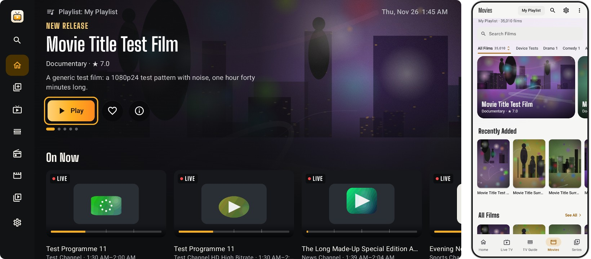

  

<h1 align="center">ElBee Player for Android</h1>

  <strong>Live TV, the TV Guide, films, series and radio from the TV service you already have, on your TV, phone and tablet.</strong>

  <picture><source media="(prefers-color-scheme: dark)" srcset="assets/brand/elbeehq-hive-on-dark.svg"></picture>&nbsp;<picture><source media="(prefers-color-scheme: dark)" srcset="assets/brand/elbeehq-wordmark-on-dark.svg"></picture>

  
  
  
  
  
  
  

  <picture>
    <source media="(prefers-color-scheme: dark)" srcset="assets/screenshot-dark.jpg">
    
  </picture>

ElBee Player plays the channels, programme guide, films and series from the TV service you already subscribe to.
Sign in with your provider's server address, username and password, or add a playlist link. It comes with no
channels or content of its own: it's the player, and your service is the content.

One app for your phone, your tablet and your TV. It's free for personal use, with no account, no adverts and no
tracking.

  

## Why ElBee Player

- **Made for the remote, and for touch.** On a TV, a side rail, large type and everything on the D-pad. On a phone
  or tablet, tabs or a navigation rail, in portrait and landscape.
- **Everything in one place.** Live TV, the TV Guide, catch-up, films, series and radio, from one sign-in.
- **Your country first.** Choose your country and its categories lead every list, followed by the countries that
  share its language. Show Content In hides the languages you don't watch.
- **Private by design.** Recommendations are worked out on your device. Your sign-in details are sealed with a key
  that never leaves the device (Android Keystore) and go only to your own service. Nothing about what you watch is
  sent to us or anyone else.

## Features

### Live TV and the TV Guide
- A TV Guide that's easy to read from the sofa, with channel numbers and logos.
- Catch-up where your service offers it, and rewind live TV up to an hour even without it.
- Use Another Guide: bring your own programme guide link (XMLTV), matched to your channels automatically, with
  Match Guide Channel… for the rest and a time offset for guides in the wrong time zone.
- A mini-player stays with you while you browse.

### Films and series
- A page for every film and series, with seasons, episodes and Up Next. On TV, OK plays the next episode.
- 4K, HD, HDR and surround sound badges, so you know what you're getting.
- Spatial Audio: surround sound goes to your TV or soundbar as it is, and the player says what it's sending.
- Match Frame Rate: the TV switches to the frame rate of what you're watching, where it allows it.
- Continue Watching, Recently Added Films and Recently Added Series.

### Make it yours
- Manage Categories: hide a category, set its country, or hide a whole region at once.
- Choose Home's rows and put them in your own order, on phones, tablets and TV.
- Play In: open live TV, films or series in another player installed on the device, or ask each time.
- Favourites, History and Radio.

### Around your home
- Send from ElBee Player on your phone or Mac: on the TV, scan the code with your phone's camera and the playlist arrives, encrypted,
  with no typing with the remote.
- Send to Another Device…: send a playlist from your phone to your TV, or to ElBee Player for Mac.
- Clear messages when something goes wrong: a refresh says whether your provider answered with an error, stopped
  sending, or couldn't be reached, and tries again by itself when it can.

## Download and install

One APK works on phones, tablets, Android TV, Google TV and Fire TV. It isn't from an app store, so Android asks you
to allow the install once.

1. **Phone or tablet:** download the APK from the [latest release](https://github.com/ElBeeHQ/ElBeePlayer-Android/releases/latest)
   or [elbeehq.com/android](https://elbeehq.com/android) and open it. Allow your browser to install apps when Android
   asks, then choose **Install**.
2. **Fire TV:** download the APK from elbeehq.com/android with a browser or a file-transfer app from your Fire TV's
   app store, turn on **Settings › My Fire TV › Developer Options › Install unknown apps** for that app, and install.
   Fire TV devices that run Fire OS can install it.
3. **Android TV or Google TV:** do the same with a browser or a file-transfer app from your TV's app store, allowing
   it to install apps when Android asks. The [step-by-step guide](https://elbeehq.com/android#install) covers every device.

Needs Android 9 or later, and your own TV service.

## Getting started

1. **Add your service.** Enter the server address, username and password your provider gave you, or a playlist
   link. On a TV, choose **Send from ElBee Player on your phone or Mac** and send it from your phone instead of typing.
2. **Choose your languages and country.** Show Content In and your country decide what comes first and what's hidden.
3. **Watch.** Home shows what's new, what's on now and what you were watching.

## Updates

ElBee Player updates itself from this page. Each update is checked against ElBee Player's own signing key before it's
offered, and your playlists and settings are kept. You can turn automatic checks off in **Settings › General ›
Updates**. Every change is listed in [What's New](CHANGELOG.md).

## Also from ElBeeHQ

- [**ElBee Player for Mac**](https://elbeehq.com/mac): the same service on a Mac, with Add from Your Phone to bring
  your playlist across with a scan.
- [**ElBee Stats**](https://elbeehq.com/stats/): download statistics for your own GitHub releases, on a Mac.

## Links

[What's New](CHANGELOG.md) · [Help](https://elbeehq.com/support) · [Report a problem](https://github.com/ElBeeHQ/ElBeePlayer-Android/issues) ·
[Privacy](https://elbeehq.com/privacy) · [Legal & Terms](https://elbeehq.com/legal) · [elbeehq.com](https://elbeehq.com)

ElBee Player is a media player only. It includes no channels, films or other content; use it only with services
and media you have the right to use. ElBeeHQ is not affiliated with, endorsed by or sponsored by any broadcaster,
content owner, TV service, Google, Amazon, GitHub or the FFmpeg project. Android, Android TV and Google TV are
trademarks of Google LLC. Fire TV and Fire OS are trademarks of Amazon.com, Inc. or its affiliates. GitHub is a
trademark of GitHub, Inc. Other names belong to their owners and are used only to describe compatibility.

© 2026 ElBeeHQ. Free for personal, non-commercial use; see [LICENSE](LICENSE). ElBee Player includes FFmpeg
(audio decoders only; LGPL 2.1 or later, unmodified, with its source and build script in [licenses/](licenses/) and
on every release, so you can use your own build), AndroidX Media3, Jetpack Compose, OkHttp, Coil, Haze (Apache 2.0)
and Bouncy Castle (MIT); their licences are in [licenses/](licenses/) and in the app.
